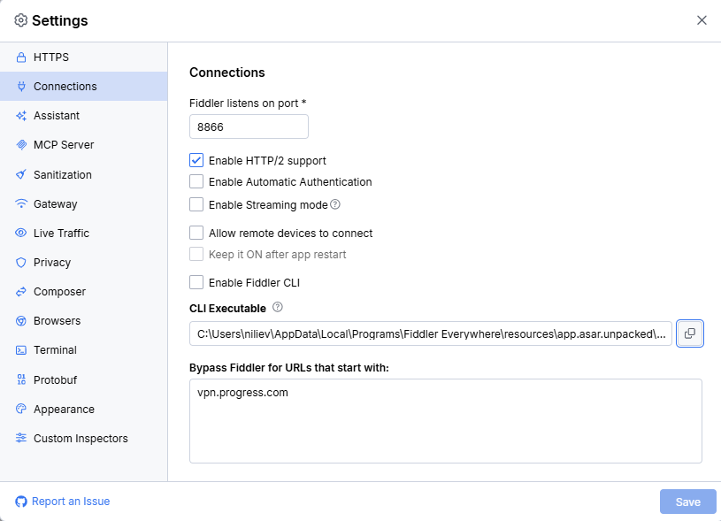

# Fiddler CLI

The **Fiddler CLI** lets you control Fiddler Everywhere from a terminal through the bundled `fiddler-cli` command. Use it to automate repetitive tasks or to drive Fiddler Everywhere from scripts on your machine. With `fiddler-cli`, you can:

- Start and stop traffic capturing.
- Show, hide, and query the status of the Fiddler Everywhere application.
- Clear live sessions or export them to a SAZ file.
- Pause matching requests and responses with breakpoints, and resume them.
- Apply temporary URL replacements and host overrides.
- Run custom commands that you implement in a [C# script](slug://fiddler-script-cli-commands).

All commands use the following syntax:

```sh
fiddler-cli [--hidden] <command> [arguments]
```

The command names follow the Fiddler Classic shorthand syntax&mdash;for example, `bpu`, `bpafter`, `urlreplace`, and `go`. For the full list of commands, see the [Fiddler CLI Command Reference](slug://fiddler-cli-commands).

To start using the Fiddler CLI, complete the following steps:

1. [Enable the Fiddler CLI](#enabling-the-fiddler-cli) in the Fiddler Everywhere settings. The CLI is disabled by default.
1. [Set up the CLI path](#setting-up-the-cli-path) for your operating system, so that your terminal can find the `fiddler-cli` command.
1. [Run a command](#running-commands).

## Prerequisites

To use the Fiddler CLI, you need:

- Fiddler Everywhere installed on Windows, macOS, or Linux (AppImage). The CLI is bundled with the application and is self-contained, so you don't need to install a separate .NET runtime.
- A Fiddler Everywhere **Pro** or **Enterprise** subscription tier.
- A signed-in Fiddler account with a valid license for most commands. For details, see [Restrictions](#restrictions).

## Enabling the Fiddler CLI

The Fiddler CLI is **disabled by default**. To enable it:

1. In Fiddler Everywhere, open **Settings** > **Connections**.
1. Select the **Enable Fiddler CLI** checkbox.
1. Click **Save**.



<!-- TODO screenshot: Replace with the updated Settings > Connections screenshot. On Windows and macOS, the path field is now labeled "CLI Directory" and shows the folder, not the executable. -->

The option controls only whether Fiddler Everywhere accepts commands from `fiddler-cli`. It doesn't install the command and doesn't change your `PATH`. Fiddler Everywhere never modifies the `PATH` environment variable for you&mdash;you set it up yourself, as described in the next section.

When the option is disabled, running any `fiddler-cli` command prints `Fiddler CLI is currently disabled.` and returns exit code `1`. The CLI does not start Fiddler Everywhere.

>tip The checkbox is unavailable when your subscription tier doesn't include the Fiddler CLI or when your administrator has disabled the CLI through the [`DisableCLI` policy](slug://fe-restrict-policies).

## Setting Up the CLI Path

Fiddler Everywhere doesn't register the `fiddler-cli` command on your `PATH` during installation. To run the command, use one of the following approaches:

- **Run the executable by its full path**&mdash;Works immediately and requires no configuration.
- **Add the executable's folder to the `PATH` environment variable**&mdash;Lets you run `fiddler-cli` from any terminal and any folder.

### Copying the CLI Path

Fiddler Everywhere shows the location of the CLI in the settings. On Windows and macOS, the field is named **CLI Directory** and contains the folder of the executable. On Linux, the field is named **CLI Executable** and contains the full path to the executable.

1. Open **Settings** > **Connections**.
1. Find the **CLI Directory** (Windows and macOS) or **CLI Executable** (Linux) field below the **Enable Fiddler CLI** checkbox.
1. Click the copy button next to the field. Fiddler Everywhere confirms with the **CLI Path Copied!** message.

The copied value is the folder that contains iddler-cli on Windows and macOS, and the full path to the executable on Linux. The location depends on your operating system and installation:

| Operating System | Field | Copied Value |
|:-----------------|:------|:-------------|
| Windows | **CLI Directory** | `<installation folder>\resources\app.asar.unpacked\out\cli`<br>For a per-user installation, for example, `%LOCALAPPDATA%\Programs\Fiddler Everywhere\resources\app.asar.unpacked\out\cli`. Add this folder to `PATH`. |
| macOS | **CLI Directory** | `/Applications/Fiddler Everywhere.app/Contents/Resources/app.asar.unpacked/out/cli`. Add this folder to `PATH`. |
| Linux (AppImage) | **CLI Executable** | The full path to `fiddler-cli`, inside the mounted AppImage. The path is temporary and valid only while Fiddler Everywhere is running. Adding it to `PATH` is not recommended. See [Linux](#linux). |

>important Always use the path shown in the **CLI Directory** field of your installation. The folder differs between per-user and per-machine installations on Windows and if you install the app in a custom location.

### Windows

Open **PowerShell** or **Command Prompt** and use one of the following options.

The examples use the `LOCALAPPDATA` environment variable (`%LOCALAPPDATA%` in Command Prompt and `$env:LOCALAPPDATA` in PowerShell), which points to `C:\Users\<user>\AppData\Local` and matches the default per-user installation folder. Don't use `%APPDATA%`&mdash;it points to the `Roaming` folder, which is a different location. If you installed Fiddler Everywhere per machine or in a custom folder, replace the variable-based part of the path with the folder from the **CLI Directory** field.

**Option 1: Run the executable by its full path**

Paste the copied folder, append `\fiddler-cli.exe`, and add the command. In PowerShell, put the path in quotes and prefix it with the call operator (`&`) because it contains spaces:

```powershell
# Windows PowerShell
& "$env:LOCALAPPDATA\Programs\Fiddler Everywhere\resources\app.asar.unpacked\out\cli\fiddler-cli.exe" help
```

```bat
:: Command Prompt
"%LOCALAPPDATA%\Programs\Fiddler Everywhere\resources\app.asar.unpacked\out\cli\fiddler-cli.exe" help
```

**Option 2: Add the folder to PATH for the current terminal session only**

The change is lost when you close the terminal:

```powershell
# Windows PowerShell
$env:Path += ";$env:LOCALAPPDATA\Programs\Fiddler Everywhere\resources\app.asar.unpacked\out\cli"
fiddler-cli help
```

```bat
:: Command Prompt
set "PATH=%PATH%;%LOCALAPPDATA%\Programs\Fiddler Everywhere\resources\app.asar.unpacked\out\cli"
fiddler-cli help
```

**Option 3: Add the folder to the user PATH permanently**

Use the Windows settings:

1. Press the **Windows** key, type `environment variables`, and select **Edit environment variables for your account**.
1. In the **User variables** list, select **Path** and click **Edit**.
1. Click **New** and paste the folder that contains `fiddler-cli.exe`. Don't include `fiddler-cli.exe` in the value.
1. Click **OK** in all dialogs.
1. Open a **new** terminal window. Terminals that were already open don't see the change.

Alternatively, run the following command in PowerShell. Replace the folder with the one for your installation:

```powershell
# Windows PowerShell
$cliFolder = "$env:LOCALAPPDATA\Programs\Fiddler Everywhere\resources\app.asar.unpacked\out\cli"
$userPath = [Environment]::GetEnvironmentVariable("Path", "User")
if (($userPath -split ";") -notcontains $cliFolder) {
    [Environment]::SetEnvironmentVariable("Path", "$userPath;$cliFolder", "User")
}
```

Open a new terminal window and verify the setup:

```powershell
where.exe fiddler-cli
fiddler-cli help
```

>tip Avoid the `setx PATH ...` command. It truncates values longer than 1024 characters and can damage your existing `PATH`.

### macOS

Open **Terminal** and use one of the following options.

**Option 1: Run the executable by its full path**

Paste the copied folder, append `/fiddler-cli`, and add the command. Wrap the path in quotes because it contains a space:

```sh
"/Applications/Fiddler Everywhere.app/Contents/Resources/app.asar.unpacked/out/cli/fiddler-cli" help
```

**Option 2: Create a symbolic link in /usr/local/bin**

The `/usr/local/bin` folder is usually already part of your `PATH`, so a symbolic link makes the command available in every terminal:

```sh
sudo mkdir -p /usr/local/bin
sudo ln -sf "/Applications/Fiddler Everywhere.app/Contents/Resources/app.asar.unpacked/out/cli/fiddler-cli" /usr/local/bin/fiddler-cli
```

Enter your administrator password when prompted. Open a new terminal window and verify the setup:

```sh
which fiddler-cli
fiddler-cli help
```

**Option 3: Add the folder to PATH in your shell profile**

Add the folder that contains `fiddler-cli` to your shell profile. Current macOS versions use `zsh` by default, so the profile is `~/.zshrc`. If you use `bash`, use `~/.bash_profile` instead.

```sh
echo 'export PATH="$PATH:/Applications/Fiddler Everywhere.app/Contents/Resources/app.asar.unpacked/out/cli"' >> ~/.zshrc
source ~/.zshrc
```

Verify the setup:

```sh
which fiddler-cli
fiddler-cli help
```

If you moved the application out of the `/Applications` folder, replace the folder in the commands with the one from the **CLI Directory** field.

### Linux

Fiddler Everywhere for Linux is distributed as an AppImage. An AppImage is mounted to a temporary folder while the application is running, so the **CLI Executable** path is **temporary**&mdash;it is valid only while Fiddler Everywhere is running and typically changes with each start.

<!-- TODO verify: Confirm that the AppImage mount path changes on each start and that the CLI executable cannot be used after Fiddler Everywhere closes. -->

Because of that, use the full path of the running instance instead of adding a folder to the `PATH` permanently:

1. Start Fiddler Everywhere.
1. Open **Settings** > **Connections** and click the copy button next to the **CLI Executable** field.
1. In a terminal, run the command with the copied path:

    ```sh
    "<copied path>" help
    ```

    For example, with the path pasted between quotes:

    ```sh
    "/tmp/.mount_Fiddle1a2b3c/resources/app.asar.unpacked/out/cli/fiddler-cli" status
    ```

To use the shorter `fiddler-cli` command during the current Fiddler Everywhere session, create a temporary symbolic link or an alias to the copied path:

```sh
# Symbolic link in ~/.local/bin (make sure the folder is part of your PATH)
mkdir -p ~/.local/bin
ln -sf "<copied path>" ~/.local/bin/fiddler-cli

# Or, an alias for the current terminal session only
alias fiddler-cli='"<copied path>"'
```

Repeat these steps after you restart Fiddler Everywhere, because the copied path changes. If `~/.local/bin` is not part of your `PATH`, add it to your shell profile:

```sh
echo 'export PATH="$HOME/.local/bin:$PATH"' >> ~/.bashrc
source ~/.bashrc
```

>important On Linux, start Fiddler Everywhere before you run `fiddler-cli` commands. The CLI executable is not available while the AppImage is not running, so the CLI cannot start the application for you.

<!-- TODO verify: Confirm whether the CLI can be copied to a permanent location on Linux and still start the AppImage through ~/.fiddler/cli-config.json. -->

## Running Commands

When you run a `fiddler-cli` command, the CLI looks for a running Fiddler Everywhere instance for the current user:

- If Fiddler Everywhere is running, the CLI sends the command to it and prints the result.
- If Fiddler Everywhere is not running (Windows and macOS), the CLI starts it, waits until the application is ready, and then runs the command. This applies to every command, including `help` and invalid commands.

The CLI waits up to 30 seconds for Fiddler Everywhere to start and become ready. If the application is still starting (for example, while it restores your sign-in state), the CLI retries the command automatically during that time.

### Starting Fiddler Everywhere in the Background

Add the `--hidden` option to start Fiddler Everywhere without showing the splash screen and the main window. This is useful for automation scenarios where you don't need the UI.

```sh
fiddler-cli --hidden start
```

The `--hidden` option affects only the application startup. If Fiddler Everywhere is already running, the option has no effect. To show the window later, run `fiddler-cli show`.

### Getting Help

To list the available commands, run any of the following:

```sh
fiddler-cli help
fiddler-cli --help
fiddler-cli -h
fiddler-cli
```

<!-- TODO screenshot: Terminal output of "fiddler-cli help" -->

### Quoting Arguments

Arguments are positional. Quote values that contain spaces or characters that your shell interprets, such as `&`, `?`, or `|`:

```powershell
# Windows PowerShell
fiddler-cli bpu "example.com/api?debug=true"
```

```sh
# macOS and Linux
fiddler-cli bpu 'example.com/api?debug=true'
```

## Examples

The following examples show common tasks. For all commands, see the [Fiddler CLI Command Reference](slug://fiddler-cli-commands).

**Check the state of Fiddler Everywhere**

```sh
fiddler-cli status
```

```txt
userSignedIn: True
proxyEnabled: False
scriptingEnabled: False
```

**Start capturing, do your work, and stop capturing**

```sh
fiddler-cli start
fiddler-cli stop
```

**Start Fiddler Everywhere in the background and capture**

```sh
fiddler-cli --hidden start
```

**Pause requests to a specific URL, inspect them in Fiddler Everywhere, and resume**

```sh
fiddler-cli bpu example.com/api
fiddler-cli go
fiddler-cli bpu
```

The last command clears the breakpoint.

**Redirect a host to a local server temporarily**

```sh
fiddler-cli overridehost example.com localhost:5000
fiddler-cli overridehost
```

The last command clears the host override.

**Export the captured sessions to a SAZ file**

```powershell
# Windows PowerShell
fiddler-cli dump C:\captures
```

```sh
# macOS and Linux
fiddler-cli dump ~/captures
```

**Use the exit code in a script**

```sh
fiddler-cli start && echo "Capturing started"
```

>tip If you didn't add the CLI folder to your `PATH`, replace `fiddler-cli` in the examples with the full path to the executable. See [Setting Up the CLI Path](#setting-up-the-cli-path).
## Restrictions

The following restrictions apply to Fiddler CLI commands:

- **Enabled setting**&mdash;The **Enable Fiddler CLI** option must be turned on. It is off by default.
- **Sign-in and license**&mdash;All commands except `help`, `status`, `show`, and `hide` require a signed-in Fiddler account with a valid license. Otherwise, the CLI reports the `sign_in_required` or `license_required` error. When sign-in is required, the CLI output includes a link that opens the sign-in page.
- **Subscription tier**&mdash;The Fiddler CLI is available for the **Pro** and **Enterprise** subscription tiers. If your account's plan doesn't include the CLI, commands fail with the `policy_blocked` error.
- **Enterprise policy**&mdash;Administrators can disable the CLI through the `DisableCLI` [managed app configuration](slug://fe-restrict-policies) key. When the policy is active, commands fail with the `policy_blocked` error.
- **Custom commands**&mdash;Commands implemented in a script run only when scripting is enabled and the script that handles them is active. For details, see [Custom CLI Commands](slug://fiddler-script-cli-commands).

## Output and Exit Codes

The CLI prints successful results to the standard output and errors to the standard error. Control characters in the output are escaped (for example, as `\u{1b}`), so command output cannot change the state of your terminal.

An error message can include the following additional lines:

- `Suggested action:`&mdash;Describes how to resolve the problem.
- `You can follow the quick link:`&mdash;A link that opens the relevant page, such as the sign-in page or the **Scripting** settings.
- `errorCode:`&mdash;A machine-readable [error code](#troubleshooting).

For example:

```txt
Sign-in is required before this QuickExec command can run.
Suggested action: Open Fiddler Everywhere, sign in, and run the command again.
You can follow the quick link: https://...
errorCode: sign_in_required
```

The CLI returns one of the following exit codes:

| Exit Code | Meaning |
|:----------|:--------|
| `0` | The command succeeded, or the CLI printed the help. |
| `1` | The command ran but failed, or the CLI could not connect to or start Fiddler Everywhere. Also returned when the CLI is disabled or the command is cancelled with **Ctrl+C**. |
| `2` | Usage error: the command syntax or the number of arguments is invalid, or no built-in command or active script handled the command. |

Use the exit code to check the result in scripts. For example:

```powershell
# Windows PowerShell
fiddler-cli start
if ($LASTEXITCODE -ne 0) { Write-Error "Could not start capturing." }
```

```sh
# macOS and Linux
if ! fiddler-cli start; then
  echo "Could not start capturing." >&2
fi
```

## Troubleshooting

### The Command Is Not Found

If your terminal reports that it doesn't recognize the command, the folder of the CLI executable is not on your `PATH`:

- Windows PowerShell: `fiddler-cli : The term 'fiddler-cli' is not recognized as the name of a cmdlet, function, script file, or operable program.`
- Command Prompt: `'fiddler-cli' is not recognized as an internal or external command, operable program or batch file.`
- macOS and Linux: `fiddler-cli: command not found`

To resolve the problem, set up the CLI path as described in [Setting Up the CLI Path](#setting-up-the-cli-path), and open a new terminal window after changing the `PATH`.

### The CLI Is Disabled

The `Fiddler CLI is currently disabled.` message means that the **Enable Fiddler CLI** option is off. Enable it in **Settings** > **Connections** and click **Save**.

### Error Codes

When a command fails, the CLI prints an error message and an `errorCode` value. The following table describes the error codes and how to resolve them.

| Error Code | Message | Resolution |
|:-----------|:--------|:-----------|
| `unknown_command` | `This command is not recognized as a built-in or custom command.` or `No built-in command or active script handled this command.` | Check the command spelling and run `fiddler-cli help`. For custom commands, make sure that the active script's `OnExecAction` handler handles the command. |
| `invalid_arguments` | Varies by command&mdash;for example, `Usage: urlreplace <find> <replace> or urlreplace.` or `Response status must be an integer from 100 through 599.` | Correct the command arguments. See the [Fiddler CLI Command Reference](slug://fiddler-cli-commands). |
| `not_ready` | Varies&mdash;for example, Fiddler Everywhere is still restoring the sign-in state, still initializing backend services, or the main window is not available. | Wait until Fiddler Everywhere finishes starting and run the command again. |
| `sign_in_required` | `Sign-in is required before this QuickExec command can run.` | Sign in to Fiddler Everywhere (use the link in the output) and run the command again. |
| `license_required` | `A valid Fiddler Everywhere license is required before this QuickExec command can run.` | Open Fiddler Everywhere and check your license or account state. |
| `script_unavailable` | Varies&mdash;scripting is disabled, no valid script is active, scripting was disabled after repeated script failures, or the active script has no `OnExecAction` handler. | Open the **Scripting** tab, enable scripting, and activate a valid script that has an `OnExecAction` handler. See [Custom CLI Commands](slug://fiddler-script-cli-commands). |
| `script_execution_failed` | `The active script could not execute this command: ...` | Review the runtime diagnostics in the **Scripting** tab and fix the `OnExecAction` handler. |
| `policy_blocked` | `QuickExec is disabled by the DisableCLI enterprise policy.` or `QuickExec is disabled by the CLI quota for this account.` | Contact your Fiddler administrator, or check whether your subscription tier includes the Fiddler CLI. |
| `proxy_unavailable` | `Failed to enable the proxy: ...` or `Failed to disable the proxy: ...` | Check the proxy state in Fiddler Everywhere and make sure that the proxy settings are not restricted on your machine. |
| `operation_in_progress` | `Another QuickExec session command is in progress. Try again when it completes.` | Wait until the running `clear`, `cls`, or `dump` command completes and try again. |
| `operation_failed` | Varies&mdash;for example, `The command failed unexpectedly.`, `Timed out waiting for Fiddler Everywhere to start.`, or details about a failed session export. | Read the message details and run the command again. |
| `protocol_mismatch` | `QuickExec protocol version mismatch ...` | The `fiddler-cli` command and the running Fiddler Everywhere instance come from different versions. Restart Fiddler Everywhere so that both versions match. |

<!-- TODO verify: Some CLI messages still contain the internal name "QuickExec". The messages are quoted verbatim from the product; update them if the product strings are renamed to "Fiddler CLI". -->

The following message is related to the CLI configuration:

- `Could not find Fiddler Everywhere at '...'. Start or reinstall Fiddler Everywhere.`&mdash;The CLI cannot locate the application. Start Fiddler Everywhere manually, or reinstall it if the application files are missing.
- `Could not find appPath in ~/.fiddler/cli-config.json. Start Fiddler Everywhere to refresh it.`&mdash;(Linux only) The CLI configuration is missing or incomplete. Start Fiddler Everywhere manually once.

## See Also

- [Fiddler CLI Command Reference](slug://fiddler-cli-commands)
- [Custom CLI Commands](slug://fiddler-script-cli-commands)
- [Connections Settings](slug://connections-submenu)
- [Scripting Overview](slug://fiddler-script)
- [Managed App Configuration](slug://fe-restrict-policies)
