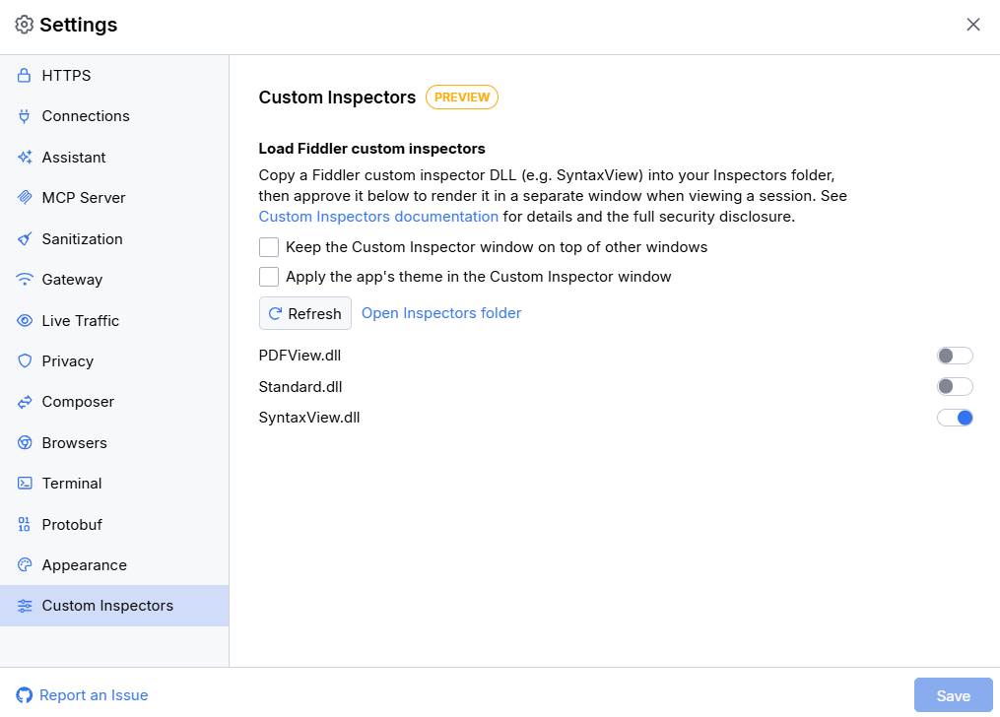
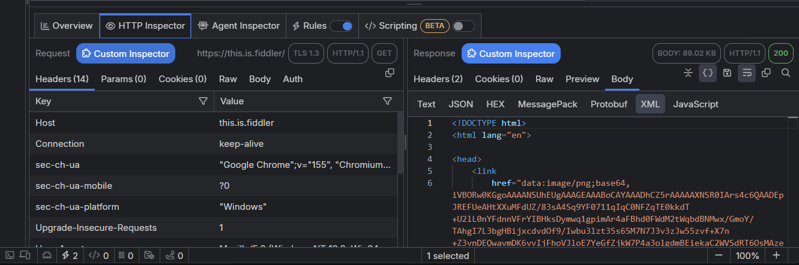
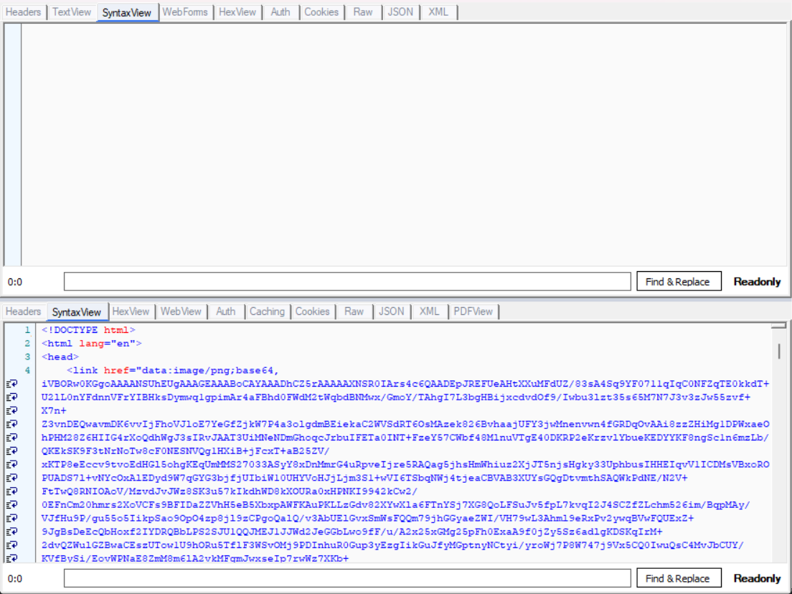

# Custom Inspectors (Preview)

Fiddler Everywhere can load and run custom inspectors built for Fiddler Classic. This lets you keep using your existing Classic inspector DLLs, such as a viewer for a proprietary protocol, while you move to Fiddler Everywhere. In most cases, the inspectors work without code changes.

>important The Custom Inspectors feature is in **preview** and is available **only on Windows**. If you notice any irregularities, report them through the [official support channels](slug://support).

## How It Works

Fiddler Classic custom inspectors are .NET Framework (WinForms) assemblies with types that derive from `Inspector2` and implement `IRequestInspector2`, `IResponseInspector2`, or both. Fiddler Everywhere provides a compatible implementation of the Fiddler Classic extensibility API and runs the inspectors in a dedicated host process (`Fiddler.InspectorHost.exe`), separate from the main application.

When you open a session in a custom inspector, Fiddler Everywhere:

1. Starts the inspector host process (or reuses the running one) and loads all approved inspectors.
1. Sends the request and response headers and bodies of the selected session to the host.
1. Displays the inspectors in a separate **Fiddler Everywhere - Custom Inspectors (Preview)** window, with the request inspectors in the upper pane and the response inspectors in the lower pane, as in Fiddler Classic.

The window stays open and follows your session selection, so you can browse the captured traffic without reopening it.

## Prerequisites

- Fiddler Everywhere running on Windows. The **Custom Inspectors** settings section and the **Custom Inspector** button are unavailable on macOS and Linux, because Classic inspectors are .NET Framework WinForms assemblies.
- A Trial, Pro, or Enterprise license. The feature is not available on Lite licenses.
- The feature is not disabled by your organization through the `DisableCustomInspectors` policy. When the policy is set, the **Custom Inspectors** settings section displays a message that your administrators have restricted the feature. For details, refer to [Managed App Configuration](slug://fe-restrict-policies).
- A custom inspector DLL built for Fiddler Classic, together with any dependency DLLs that it requires.

## Installing Custom Inspectors

You can add inspectors manually or import them from an existing Fiddler Classic installation.

### Adding Inspectors Manually

1. In Fiddler Everywhere, open **Settings** > **Custom Inspectors**.
1. Click **Open Inspectors folder**. The Inspectors folder of the currently logged-in account opens in File Explorer. The folder is located at:

    ```txt
    %USERPROFILE%\.fiddler\<account-id>\Inspectors
    ```

    Each Fiddler account has its own Inspectors folder. If you log in with a different account, you must install and approve the inspectors again.

1. Copy the inspector DLL and any DLLs that it depends on into the folder. For example, the SyntaxView inspector requires the accompanying `QWhale.*.dll` files.
1. Return to **Settings** > **Custom Inspectors** and click **Refresh**. The inspector appears in the list.

Fiddler Everywhere discovers inspectors by following the same rules as Fiddler Classic:

- DLLs placed directly in the Inspectors folder are discovered.
- In subfolders whose names end with `.ext`, only DLLs whose names match `Fiddler*.dll` are discovered.
- Files that Fiddler Classic does not treat as inspectors are skipped. These include files whose names start with `_`, the `QWhale.*`, `Be.Windows.Forms.*`, and `Telerik.WinControls.*` support libraries, `netstandard.dll`, and `samples.dll`. Such files can still exist in the folder as dependencies.
- Names reserved for the Fiddler Everywhere runtime are never loaded as inspectors: `Fiddler.dll`, `Fiddler.Extensibility*.dll`, `Fiddler.InspectorHost*.dll`, `mscorlib.dll`, and `System*.dll`.

### Importing Inspectors from Fiddler Classic

The Fiddler Classic import wizard, available in the **Home** pane, includes a **Custom Inspectors** step that copies inspectors into the Inspectors folder for you. It provides the following options, each available only if inspectors are detected in the corresponding location:

- **Custom Inspectors from your Fiddler Classic install folder**&mdash;Imports the inspectors that you added to the Fiddler Classic installation directory. The inspectors that ship with Fiddler Classic by default are excluded.
- **Custom Inspectors from your Fiddler Classic user folder**&mdash;Imports the inspectors from the `Documents\Fiddler2\Inspectors` folder.

The wizard only copies files. Imported inspectors are not approved automatically. You must approve them in **Settings** > **Custom Inspectors** before they can load. For more information about the wizard, refer to the [Fiddler Classic Migration](slug://fe-migrating-from-classic) article.

>tip The wizard skips the inspectors that ship with Fiddler Classic, such as `Standard.dll` (which provides the **Headers**, **TextView**, **HexView**, **Raw**, **JSON**, **XML**, and other built-in inspectors) and `SyntaxView.dll`. To use them in Fiddler Everywhere, copy them manually from the `Inspectors` subfolder of your Fiddler Classic installation, together with their dependencies.

## Approving Custom Inspectors

Fiddler Everywhere never loads an inspector until you explicitly approve it.



1. Open **Settings** > **Custom Inspectors**. The section lists each inspector DLL discovered in the Inspectors folder. If no DLLs are found, the section displays **No custom inspector DLLs were found in your Inspectors folder.**
1. Turn on the switch next to the inspector that you want to use.
1. Read the **Approve Custom Inspector** dialog carefully and click **Approve** to confirm. The dialog explains that the inspector runs with the full privileges of your user account, receives the complete decrypted traffic of every session that you open in it, and cannot be restricted or sandboxed once loaded.

To revoke the approval, turn off the switch. The change takes effect immediately and does not require confirmation.

The approval is bound to the exact file content through a SHA-256 hash. If the DLL changes, for example, after an update or a rebuild, the inspector automatically returns to the not-approved state and you must approve it again.

### Settings Options

The **Custom Inspectors** section also provides the following options:

- **Keep the Custom Inspector window on top of other windows**&mdash;Keeps the custom inspector window above all other windows.
- **Apply the app's theme in the Custom Inspector window**&mdash;Applies the current light or dark Fiddler Everywhere theme to the window frame and tab strips. The content rendered by the inspector itself keeps its own styling.
- **Refresh**&mdash;Rescans the Inspectors folder.
- **Open Inspectors folder**&mdash;Opens the Inspectors folder in File Explorer.

## Using Custom Inspectors

To open a session in the custom inspectors:

1. Capture traffic and select a single session in the **Live Traffic** list.
1. In the **HTTP Inspector** tab, click the **Custom Inspector** button next to the **Request** or **Response** section title. The button is visible only when at least one inspector is approved. It is also available in the request and response inspectors of the **Composer**.

    

1. The **Fiddler Everywhere - Custom Inspectors (Preview)** window opens. The window title also shows the URL of the inspected session.

The window follows the Fiddler Classic inspectors layout:

- The upper pane contains the request inspectors and the lower pane contains the response inspectors.
- Each pane displays one tab per approved inspector that supports the corresponding side. An inspector that implements both `IRequestInspector2` and `IResponseInspector2` appears in both panes.
- The tab names and the content are rendered by the inspectors themselves, so they look the same as in Fiddler Classic. For example, the following screenshot shows the Fiddler Classic built-in inspectors (**Headers**, **TextView**, **WebForms**, **HexView**, **Raw**, **JSON**, **XML**, and others) together with **SyntaxView**.



Because the preview is read-only, inspectors that support editing show their read-only state. For example, SyntaxView displays a **Readonly** indicator, and you cannot modify the session from the window.

While the window is open:

- Select another session in Fiddler Everywhere to update the window content. If you select multiple sessions or none, the window prompts you to select exactly one session.
- Click the **Custom Inspector** button again to bring the existing window to the front. Fiddler Everywhere does not open a second window.
- Use the **Keep the Custom Inspector window on top of other windows** setting to keep the window visible while you browse the traffic in the main window.

### Working with Encoded Bodies

As in Fiddler Classic, custom inspectors receive the original headers and the encoded body bytes. Some inspectors decode the content themselves, while others display the raw encoded bytes. When the request or response body is encoded (for example, chunked or compressed with gzip, deflate, or Brotli), the window displays a yellow **Request body is encoded. Click to decode.** or **Response body is encoded. Click to decode.** banner above the corresponding tab strip.

Click the banner to decode that body and refresh the selected inspector. Decoding removes the encoding headers and updates the `Content-Length` header only for the copy displayed in the custom inspector window. The captured session in Fiddler Everywhere remains unchanged. Selecting another session restores the original, encoded representation.

If decoding fails, for example, because the decoded body is too large, the body and headers remain unchanged and the window displays an error.

### Large Bodies

The request and response bodies sent to the custom inspector window share a combined limit of 10 MB per session. If a body exceeds the available space, the inspector receives a truncated copy that ends with the `*** FIDDLER: Display truncated. ***` marker, and the window displays a warning banner. The captured session is not affected.

## Limitations

The current preview has the following limitations:

- **Windows only**&mdash;The feature is not available on macOS and Linux.
- **Read-only**&mdash;Sessions are always displayed in read-only mode, even if the inspector UI looks editable. Changes made in an inspector are not applied to the session.
- **Separate window**&mdash;Custom inspectors are displayed in a dedicated window and not as tabs next to the built-in Fiddler Everywhere inspectors.
- **HTTP request and response inspectors only**&mdash;Only inspectors that implement `IRequestInspector2` or `IResponseInspector2` are loaded. WebSocket message inspectors (`IWSMInspector`) are not supported.
- **API coverage**&mdash;Fiddler Everywhere implements the part of the Fiddler Classic API that inspectors commonly use, such as `Session`, `HTTPHeaders`, `Inspector2`, `FiddlerApplication`, `CONFIG`, and `Utilities`. Inspectors that depend on other Fiddler Classic APIs might fail to load or work only partially.
- **Version requirements**&mdash;Like Fiddler Classic, Fiddler Everywhere loads only assemblies that declare the `Fiddler.RequiredVersion` attribute. Inspectors that require a newer Fiddler version than the supported one are not loaded.
- **Custom decryption**&mdash;Fiddler Everywhere does not provide additional certificate or decryption configuration for custom inspectors. If an inspector decrypts a proprietary protocol, for example, by using a machine-specific certificate, the inspector must continue to handle the decryption itself.

## Security Considerations

Custom inspectors are third-party code that runs on your machine. Before you approve an inspector, consider the following:

- **Inspectors are not sandboxed**&mdash;An approved inspector runs with the full privileges of your Windows user account. It receives the complete decrypted content of every session that you open in it, including cookies, credentials, tokens, and API keys in headers and bodies. It can read and write files and send data over the network.
- **Approval is a consent record, not a verification**&mdash;Fiddler Everywhere does not verify code signatures or scan inspector DLLs. Approve only inspectors that you built yourself or obtained from a source that you fully trust.
- **Read-only mode is not a security control**&mdash;The inspector code runs as soon as the DLL is loaded, regardless of the read-only mode.
- **Process isolation**&mdash;Inspectors run in a separate process that communicates with Fiddler Everywhere only through a private, per-user channel with a fixed set of data messages. Inspectors cannot access the internal state of Fiddler Everywhere, and the host process is terminated when Fiddler Everywhere exits.
- **Administrative control**&mdash;Organizations can disable the feature entirely through the `DisableCustomInspectors` policy.

## Troubleshooting

| Symptom | Possible cause and solution |
|:--------|:----------------------------|
| The inspector is not listed in **Settings** > **Custom Inspectors**. | Verify that the DLL is in the Inspectors folder of the account you are logged in with and click **Refresh**. If the DLL is in a `.ext` subfolder, make sure its name matches `Fiddler*.dll`. Also verify that the file name is not one of the skipped or reserved names. |
| The **Custom Inspector** button is not visible. | Make sure that at least one inspector is approved and that the feature is not restricted by your license or by an administrator policy. |
| The inspector is approved but does not appear in the window. | The inspector might be missing a dependency, lack the `Fiddler.RequiredVersion` attribute, require a newer Fiddler version, or use an unsupported Fiddler Classic API. Check the [Fiddler Everywhere logs](slug://fiddler-log-files) for load errors. |
| An approved inspector became not approved. | The DLL changed on disk. Review the new file and approve it again. |
| The inspector displays unreadable binary content. | The body is likely encoded. Click the yellow decode banner above the tab strip. |

## Reporting Issues

The Custom Inspectors feature is in preview. Report any irregularities, compatibility problems, or inspectors that fail to load through the [official support channels](slug://support). To help with the investigation, include the following details:

- The Fiddler Everywhere version.
- The name of the inspector and, if possible, its source or a minimal sample.
- The steps to reproduce the issue.
- The [Fiddler Everywhere logs](slug://fiddler-log-files).

## Roadmap

The current preview is the first stage of custom inspector support. Future versions are planned to provide a cleaner extensibility model based on the `Fiddler.Extensibility.dll` reference assembly and to render custom inspectors as tabs next to the built-in inspectors, without a separate window. This approach is expected to make custom inspectors available on macOS as well.

## See Also

- [Fiddler Classic Migration](slug://fe-migrating-from-classic)
- [Inspecting Traffic](slug://inspecting-traffic-get-started)
- [Managed App Configuration](slug://fe-restrict-policies)
- [Accessing Fiddler Everywhere Logs](slug://fiddler-log-files)
