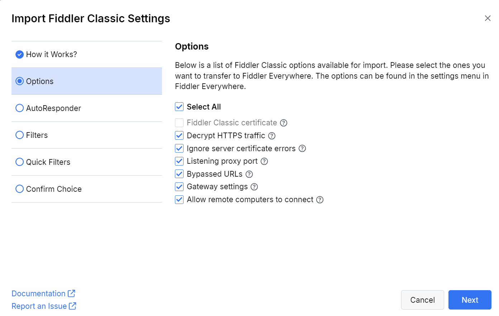
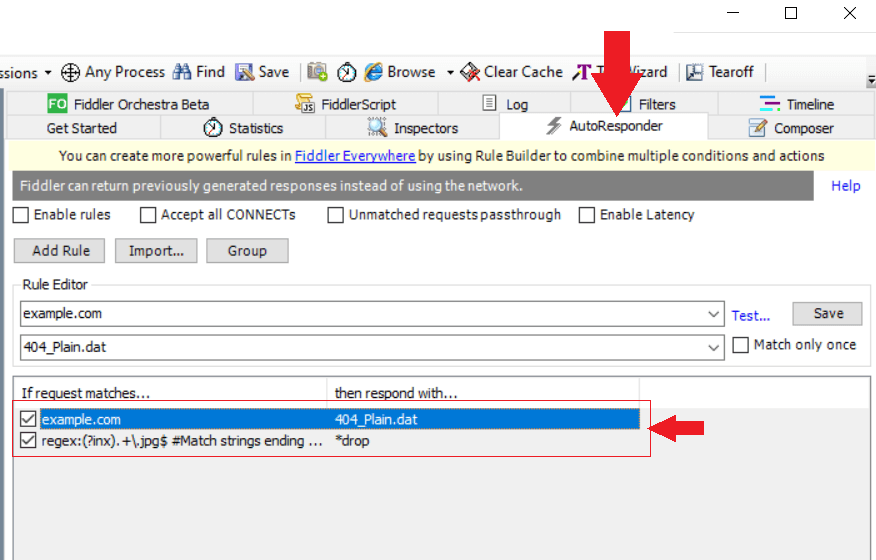
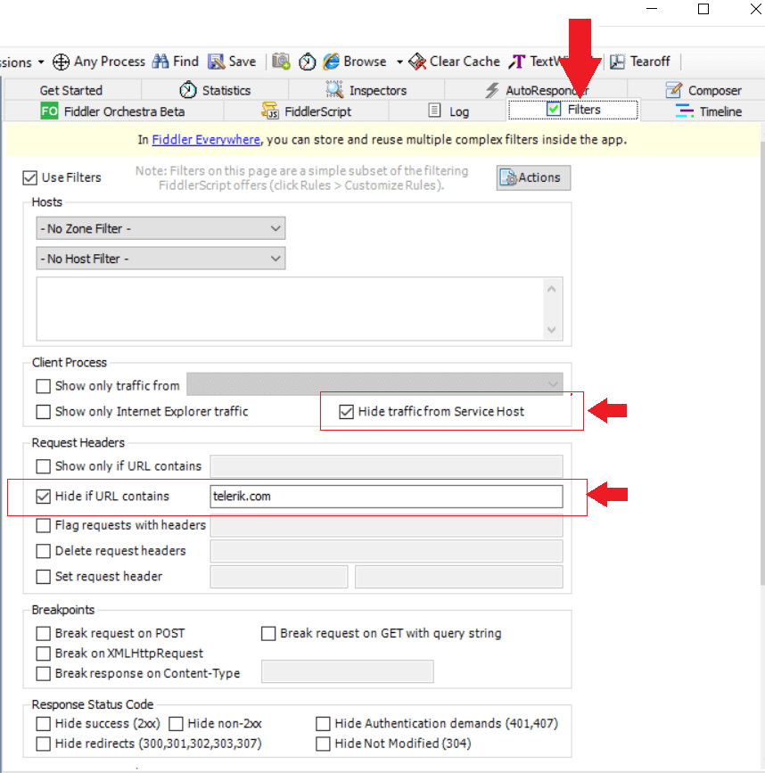
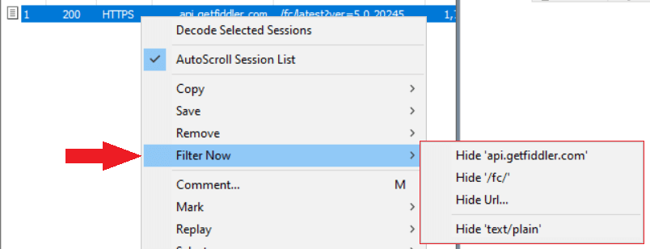
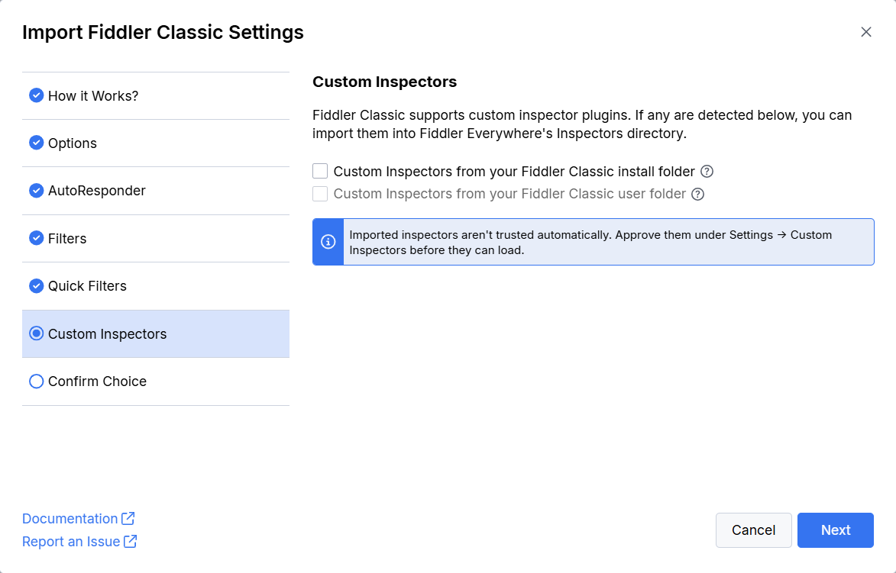

# Fiddler Classic Migration

As of August 3, 2026, Fiddler Classic is available for personal, non-commercial use only under its updated EULA. It is no longer in active development and does not include commitments for releases, patches, or technical support. Commercial and enterprise use requires Fiddler Everywhere, which is the licensed Fiddler offering for teams and organizations.

Even before the EULA update, many users had already been migrating to Fiddler Everywhere for its cross-platform support, extended protocol coverage, and active development. To make the transition easier, Fiddler Everywhere includes a built-in import wizard that carries over your existing settings, rules, filters, and custom inspectors from Fiddler Classic.

## Comparing Fiddler Classic and Fiddler Everywhere

The following table compares the two products:

| Feature          | Fiddler Classic   | Fiddler Everywhere     |
|:-----------------|:------------------|:-----------------------|
| License and usage  | Personal, non-commercial use only | Commercial, team, and enterprise use |
| OS support       | Windows only      | Windows, macOS, and Linux  |
| System proxy     | Windows only      | Windows, macOS, and Linux  |
| Low-level network capturing | No     | Yes (Windows and macOS) |
| Sandboxed browser capturing | No     | Yes |
| Rules to modify traffic | AutoResponder (limited options) | Rules (enhanced functionality) |
| Comparing HTTP sessions | Third-party extensions | Built-in **Comparison** tab |
| Filters | Limited predefined options | Advanced filtering options |
| Collaboration | Manual export | Sharing, local and cloud saves, and manual export |
| Supported HTTP versions | HTTP/1.x | HTTP/1.x and HTTP/2 |
| Maximum supported TLS version | TLS 1.2 | TLS 1.3 |
| Streaming protocols | WebSocket | WebSocket, SSE, Socket.IO, and gRPC |
| Statistical and analytical data | **Statistics** tab | **Overview** tab with enhanced statistical data and diagrams |
| Redirecting a host to a different host, IP, or port | **Tools** > **HOSTS** | [Host Remapping](slug://host-remapping) (**Tools** menu or status bar) with per-mapping port and protocol override and import from the OS hosts file |
| Custom inspectors | Yes (.NET Framework WinForms plugins) | Yes, in preview on Windows. Fiddler Everywhere can [reuse Fiddler Classic custom inspectors](slug://custom-inspectors). |
| AI assistant | No | Yes |
| MCP server | No | Yes |
| Enterprise options | No | Technical support, SSO login, offline mode, managed app configuration, and more |

## Using the Import Wizard

Starting with version 5.20.0, Fiddler Everywhere provides the built-in **Import Fiddler Classic Settings** wizard for importing configuration from Fiddler Classic. To start it, open the **Home** pane in Fiddler Everywhere.

The wizard guides you through the **How it Works?**, **Options**, **AutoResponder**, **Filters**, **Quick Filters**, **Custom Inspectors**, and **Confirm Choice** steps, where you can select which of the following items to import:

- [Application options](#importing-application-options)
- [AutoResponder rules](#importing-autoresponder-rules)
- [Filters](#importing-filters)
- [Quick filters](#importing-quick-filters)
- [Custom inspectors](#importing-custom-inspectors) (Windows only)

An option is unavailable when Fiddler Everywhere does not detect the corresponding data in Fiddler Classic.

## Importing Application Options

The imported application options behave the same way as in Fiddler Classic. After the import, you can find and change them in the Fiddler Everywhere **Settings**.

- **Fiddler Classic certificate**&mdash;Instructs Fiddler Everywhere to use the installed Fiddler Classic root certificate authority (CA). This option is available only if you have not installed and trusted the Fiddler Everywhere CA. It is also unavailable if the Fiddler Classic certificate is not trusted or is incompatible with Fiddler Everywhere. The supported certificate generator is BouncyCastle (BCCertMaker).
- **Decrypt HTTPS traffic**&mdash;Imports the value of the Fiddler Classic **Tools** > **Options** > **HTTPS** > **Decrypt HTTPS traffic** option into the Fiddler Everywhere **Settings** > **HTTPS** > **Capture HTTPS traffic** option.
- **Ignore server certificate errors**&mdash;Imports the value of the Fiddler Classic **Tools** > **Options** > **HTTPS** > **Ignore server certificate errors (unsafe)** option into the Fiddler Everywhere **Settings** > **HTTPS** > **Ignore server certificate errors (unsafe)** option.
- **Listening proxy port**&mdash;Imports the value of the Fiddler Classic **Tools** > **Options** > **Connections** > **Fiddler listens on port** option into the Fiddler Everywhere **Settings** > **Connections** > **Fiddler listens on port** option.

    >important The default proxy port of Fiddler Classic is 8888, while the default proxy port of Fiddler Everywhere is 8866. This difference is often overlooked when following a proxy tutorial written for the other application.

- **Bypassed URLs**&mdash;Imports the value of the Fiddler Classic **Tools** > **Options** > **Connections** > **Bypass Fiddler for URLs that start with** option into the Fiddler Everywhere **Settings** > **Connections** > **Bypass Fiddler for URLs that starts with** option.
- **Gateway settings**&mdash;Imports the Fiddler Classic **Tools** > **Options** > **Gateway** configuration into the Fiddler Everywhere **Settings** > **Gateway** section. This option is unavailable if Fiddler Classic is configured to **Automatically detect proxy using WPAD**.
- **Allow remote computers to connect**&mdash;Imports the value of the Fiddler Classic **Tools** > **Options** > **Connections** > **Allow remote computers to connect** option into the Fiddler Everywhere **Settings** > **Connections** > **Allow remote devices to connect** option.

## Importing AutoResponder Rules

The Fiddler Classic **AutoResponder** feature corresponds to the **Rules** feature in Fiddler Everywhere. The wizard imports only the AutoResponder rules that are currently loaded in Fiddler Classic. After the import, you can modify or delete the rules as needed.

Additionally, you can import any exported [rules archive (FARX)](slug://fiddler-saz-format) through the **Import** button in the Fiddler Everywhere **Rules** tab.

>tip If a Fiddler Classic rule has a value in its **Comment** field, Fiddler Everywhere uses that value as the rule name. Rules without a comment receive a predefined name.

## Importing Filters

Fiddler Classic **Filters** work at a deeper level and exclude any traffic that the user has not explicitly requested. In Fiddler Everywhere, such actions are configured through the **Rules** tab, so each loaded Fiddler Classic filter is imported as a separate rule.

The wizard imports only the currently loaded filters. Alternatively, you can import Fiddler filter archives (FFX files) through the **Import** button in the Fiddler Everywhere **Rules** tab.

## Importing Quick Filters

Fiddler Classic **Quick Filters** work similarly to the filters in Fiddler Everywhere. After the import, you can find them in the **Filters** dialog under **Saved Filters**, accessible from the top left corner of the **Live Traffic** pane.

## Importing Custom Inspectors

On Windows, Fiddler Everywhere can run custom inspectors built for Fiddler Classic as a [preview feature](slug://custom-inspectors). The **Custom Inspectors** step of the wizard copies the inspector files into the Fiddler Everywhere Inspectors folder and provides the following options:

- **Custom Inspectors from your Fiddler Classic install folder**&mdash;Imports the inspectors that you added to the Fiddler Classic installation directory. The inspectors that ship with Fiddler Classic by default are excluded.
- **Custom Inspectors from your Fiddler Classic user folder**&mdash;Imports the inspectors from the `Documents\Fiddler2\Inspectors` folder.

The options are unavailable if no custom inspectors are detected, if your license does not include the feature, or if an administrator has disabled it through the `DisableCustomInspectors` policy.

To start using the imported inspectors:

1. Complete the wizard by clicking **Next** and confirming your selection on the **Confirm Choice** step.
1. Open **Settings** > **Custom Inspectors** and approve each imported inspector. Imported inspectors are not trusted automatically, and Fiddler Everywhere does not load them until you approve them.
1. Select a session and click the **Custom Inspector** button in the **HTTP Inspector** tab to open it in the Custom Inspectors window.

>important Before approving an inspector, review the security considerations. An approved inspector runs with the full privileges of your user account and receives the decrypted content of the sessions that you open in it. For details about approving and using custom inspectors, as well as the feature limitations, refer to the [Custom Inspectors](slug://custom-inspectors) article.

## See Also

- [Custom Inspectors](slug://custom-inspectors)
- [Host Remapping](slug://host-remapping)
- [Managed App Configuration](slug://fe-restrict-policies)
