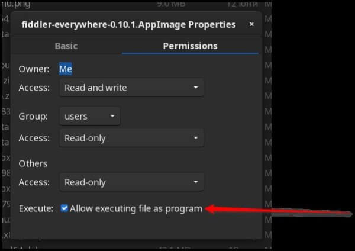
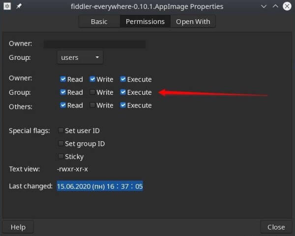
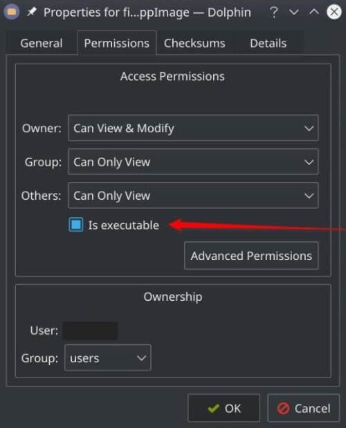

# First Steps with Fiddler Everywhere on Linux

This tutorial describes how to install and start using Fiddler Everywhere on Linux.

* First, you will go through the installation and configuration steps.
* Next, you will create a Fiddler account so that you can move on to using the web-debugging tool.
* Finally, you will see how to capture, inspect, and modify traffic.

## Prerequisites

- Install Ubuntu 22+ x64.
- Provide 400MB of free disk space.
- Use a Linux account with administrator rights, which are required to capture and decrypt HTTPS traffic.
- Provide an active Internet connection with access to the following URLs:
  ```sh
  https://*.telerik.com/
  https://*.getfiddler.com/
  https://fiddler-backend-production.s3-accelerate.amazonaws.com
  https://challenges.cloudflare.com
  ```
  >note The Telerik site (where the Fiddler authentication form resides) uses different CDNs to load various components, styles, and cookies related to its user interface. Having limited internet access can cause the site not to load correctly.
- Ensure that Fiddler Everywhere's proxy port is open and unrestricted by a firewall/security tool. By default, that is **port 8866**, but you can change it from **Settings** > **Connections** > **Fiddler listens on port**.

## Step 1: Install Fiddler Everywhere on Your Machine

Install the latest version of Fiddler Everywhere on your machine.

1. Download the latest version of [Fiddler Everywhere](https://www.telerik.com/download/fiddler-everywhere).
1. Install the downloaded package. On most Linux distributions, you must set the installation file as executable before starting the installation. To achieve this, either use the command line or the GUI of the desired distribution. 
    - Setting the downloaded AppImage file as executable through the command line:
        1. Open a terminal.
        1. Navigate to the folder where the installation file resides.
        1. Type `sudo chmod +x filename.AppImage`. You can omit `sudo` if your current account owns the downloaded file.
        1. If prompted, enter your username and password. Press the `Enter` key.
    - Setting the downloaded AppImage file as executable through the GUI.
        * For the Gnome distribution
          
        * For the Cinnamon distribution
          
        * For the KDE desktop environment
          

### Ubuntu 24.04 Specifics

Recent reports on Ubuntu 24.04 describe an issue affecting some Electron-based applications, including Fiddler Everywhere, where AppImage files cannot be marked as executable (see [this GitHub thread](https://github.com/electron/electron/issues/42510)). If you cannot launch the Fiddler AppImage after following the steps above, try the following:

1. Open a terminal
1. Run the following command:
 
  ```bash
  sudo apt install libfuse2
  ```

The command installs the required dependencies to run AppImage files on Ubuntu 24.04. If the application does not start, launch it from a terminal and check the output for errors. If you see the error "The SUID sandbox helper binary was found, but is not configured correctly," add the `--no-sandbox` command-line option when starting the application from the terminal.

### Fiddler CLI

Fiddler Everywhere includes the bundled [`fiddler-cli` command](slug://fiddler-cli) for controlling the application from a terminal. The CLI is disabled by default, and Fiddler Everywhere does not register it on your `PATH`. To use it, enable **Settings** > **Connections** > **Enable Fiddler CLI**, copy the temporary **CLI Executable** path, and [run the command by its full path](slug://fiddler-cli#linux).

## Step 2: Create Your Fiddler Account

In this step, you will register by creating your unified Telerik account.   

1. Launch the Fiddler Everywhere application. Follow the **Sign in or create an account** link.
1. Create an account using email and password or using the **Sign in with Google** option.
  >tip The [Fiddler Everywhere Enterprise subscription plan](https://www.telerik.com/purchase/fiddler) supports SSO login. Refer to the [Single Sign-On (SSO) Setup]() article for detailed instructions on configuring your company-specific SSO.
1. Enter the requested information on the **Enter Your Email to Sign in or Create an Account** screen.
1. Check your inbox, open the confirmation email, and complete your account activation.
1. Return to the Fiddler Everywhere application and choose whether to start a trial or purchase a subscription by selecting **Start Free Trial** or **BUY NOW**.

After you sign in to Fiddler Everywhere, your personal and license information appears in the **Home** pane.

## Step 3: Interact with the Captured Traffic

You can now take advantage of the Fiddler Everywhere capabilities - capture, inspect, save & share, import & export, mock and modify HTTPS traffic.

1. Capture HTTPS traffic through the preferred [capturing mode](slug://capture-traffic-get-started).
  >tip To capture and decrypt secure HTTPS traffic, you need to explicitly [install and trust the Fiddler certificate authority (CA)](slug://trust-certificate). Alternatively, you can install the Fiddler CA certificate in a third-party certificate store (for example, [install the CA in Firefox](slug://how-to-install-fiddler-root-certificate-in-firefox-on-linux)) and capture traffic only from that application.
1. [Inspect the captured data](slug://inspecting-traffic-get-started).
1. [Save](slug://fiddler-saving), [share](slug://fiddler-sharing), or [export](slug://fiddler-export-and-import) the captured HTTPS traffic.
1. [Modify a session through the **Composer**](slug://composer-get-started#edit-captured-api-request)
1. [Mock client and server behavior through the **Rules** tab](slug://rulesbuilder-get-started)

>tip The **Rules** tab is one of the most advanced features in Fiddler Everywhere. You can create and execute complex rules on your incoming traffic to mock client and server behavior without touching the client and server applications.

Now you are equipped to delve deeper into Fiddler Everywhere and make the most of its powerful functionalities.

## Next Steps

* [Learn more about the capturing options with Fiddler Everywhere](slug://capture-traffic-get-started)
* [Learn more about installing the Fiddler CA certificate to decrypt secure HTTPS traffic](slug://trust-certificate)
* [Sharing captured sessions with collaborators](slug://fiddler-sharing)
* [Creating API requests](slug://composer-get-started)
* [Grouping the API requests in collections](slug://composer-collections-get-started)
* [Mocking server responses](slug://rulesbuilder-get-started)
* [Controlling Fiddler Everywhere from the command line](slug://fiddler-cli)
* [Configuring Fiddler Everywhere on Fedora, CentOS, or RedHat](slug://fiddler-fedora-centos)
* [Configuring Fiddler Everywhere on XFCE](slug://fiddler-xfce)
* [Creating PEM certificate](slug://how-to-create-pem)
* [Setting Up the Fiddler CA certificate for Electron-based Applications](slug://ubuntu-ca-electron)
* [Setting Up the Fiddler CA certificate in Firefox](slug://how-to-install-fiddler-root-certificate-in-firefox-on-linux)

